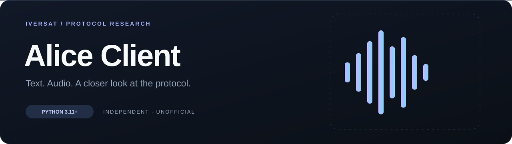

# Alice Client

Я разрабатываю Alice Client для работы с Алисой из Python: текстового диалога, синтеза речи и голосового общения. В одном проекте я объединил WebSocket-клиент, вход в Яндекс и локальное распознавание русского и английского языка.

**Python 3.11+** · **Asyncio** · **RU / EN** · **CLI**

[Установка](#установка) · [Вход в аккаунт](#вход-в-аккаунт) · [Команды](#команды) · [Голосовой режим](#голосовой-режим) · [Python API](#python-api)

Я веду этот проект независимо от Яндекса и использую недокументированный интерфейс Uniproxy. Доступность ответов и функций зависит от сервера и прав аккаунта. Сведения об источниках я собрал в [PROVENANCE.md](PROVENANCE.md), условия использования — в [LEGAL_NOTICE.md](LEGAL_NOTICE.md).

## Установка

```powershell
git clone https://github.com/Iversat/Alice-Client.git
cd Alice-Client
py -m venv .venv
.\.venv\Scripts\python.exe -m pip install -e .
.\.venv\Scripts\python.exe -m alice_client chat --anonymous --text "Привет"
```

В Linux и macOS используйте `python3 -m venv .venv` и `.venv/bin/python` вместо пути Windows. Активация окружения необязательна.

После установки доступны команды `alice-client` и `alice-login`. Я сохранил модуль `alice_client`, имена исходных скриптов и совместимые команды `ls-client` / `ls-login`. Папка проекта может называться произвольно.

## Обновление прежней установки

Если вы устанавливали проект под старым именем, я рекомендую удалить прежний пакет из того же виртуального окружения перед обновлением: разные пакеты могут содержать одинаковые Python-модули и команды.

```powershell
.\.venv\Scripts\python.exe -m pip uninstall ls-client alice-client-research
.\.venv\Scripts\python.exe -m pip install -e ".[voice]"
```

## Вход в аккаунт

```powershell
.\.venv\Scripts\python.exe yandex_login.py
```

Откроется сайт Яндекса. Войдите в нужный аккаунт и подтвердите вход. Скрипт дождётся результата, проверит токен и сохранит его в `.env` рядом со скриптом. Создавать OAuth-приложение и вручную копировать токен для этого способа не требуется.

```powershell
.\.venv\Scripts\python.exe -m alice_client chat
```

Клиент читает токен из окружения процесса, затем из `.env` в текущей папке, затем из системного хранилища. `--anonymous` отключает все эти источники. `--token-prompt` запрашивает токен скрытым вводом на один запуск.

Для ссылки без автоматического открытия браузера используйте `yandex_login.py --no-browser`; `--wait 300` ограничивает ожидание. При отказе или отмене старый `.env` сохраняется.

Я адаптировал протокол входа по [AlexxIT/YandexStation](https://github.com/AlexxIT/YandexStation/blob/master/custom_components/yandex_station/core/yandex_session.py); атрибуция и условия лицензии сохранены в [THIRD_PARTY_NOTICES.md](THIRD_PARTY_NOTICES.md). Скрипт работает со своей временной сессией Passport. Пароль вводится на сайте Яндекса, cookies существующего профиля браузера не извлекаются.

`.env` содержит токен открытым текстом: храните его локально и не публикуйте. Альтернативный официальный OAuth-вход со своим приложением и системным хранилищем описан в [руководстве по авторизации](docs/AUTH.md).

## Команды

| Задача | Команда после `python -m alice_client` |
| --- | --- |
| Один запрос без аккаунта | `chat --anonymous --text "Привет"` |
| Один запрос с сохранённым токеном | `chat --text "Привет"` |
| Диалог с контекстом | `chat` |
| Диалог и сохранение аудиоответов | `chat --audio` |
| Озвучить слово или предложение | `tts "Сегодня хорошая погода." --output speech.opus` |
| Озвучить и воспроизвести | `tts "Привет" --play` |
| Распознать 10 секунд микрофона | `asr --duration 10` |
| Распознать файл | `asr --file recording.wav` |
| Голосовое общение | `voice` |
| Список аудиоустройств | `devices` |
| Проверить токен и доступы | `auth status` / `auth check` |

В чате `exit`, `quit` и `выход` завершают работу. `/new` начинает новый диалог. В пределах одного клиента серверный `session_id` переносится между репликами; состояние хранится в памяти.

В `chat --audio` я запрашиваю текст и отдельно синтезирую его через TTS. Без `--output` ответы сохраняются в `responses/reply-NNN.opus`. Явно заданный путь перезаписывается при следующем сохранении. `tts --play` воспроизводит ответ; обычный `tts` только сохраняет файл.

## Голосовой режим

Один раз установите зависимости и модель:

```powershell
.\.venv\Scripts\python.exe -m pip install -e ".[voice]"
.\.venv\Scripts\python.exe -m alice_client models --lang auto
.\.venv\Scripts\python.exe -m alice_client voice
```

Одновременно работают **«Алиса»** и **“Alice”** в начале фразы: «Алиса, привет» или “Alice, what time is it?”. Можно произнести триггер отдельно, затем в течение 10 секунд сказать запрос. Свой набор задаётся повторением `--wake-word`, например `--wake-word алиса --wake-word alice`.

По умолчанию `--lang auto` использует локальную Whisper base через faster-whisper. Русский или английский выбирается для каждой фразы; язык можно менять между репликами без перезапуска. Смешанная речь, шум и короткие слова могут распознаваться с ошибками. Поддержка английского в ASR не означает, что сам сервис Алисы умеет отвечать на английские запросы.

Речь распознаётся на компьютере. До триггера текст не отправляется Яндексу; после него передаётся распознанная команда. На время запроса и озвучивания я закрываю микрофон, чтобы ответ не активировал следующий запрос. Перебивание голосом в этом режиме не поддерживается.

| Параметр | Назначение |
| --- | --- |
| `--anonymous` | Работать без аккаунта |
| `--follow-up 15` | Принимать продолжение без триггера в течение 15 секунд после ответа |
| `--once` | Завершить после одного ответа |
| `--duration 30` | Ограничить ожидание микрофона |
| `--file input.wav` | Подать аудиофайл вместо микрофона |
| `--output responses` | Сохранить аудиоответы в папку |
| `--no-play` | Синтезировать ответ без воспроизведения |
| `--device 1` | Выбрать микрофон по номеру или имени |
| `--output-device 14` | Выбрать динамики по номеру или имени |

Ctrl+C и команда «Алиса, выход» завершают голосовой режим. Запись микрофона не сохраняется. В `auto` окончательный текст появляется после паузы около 0,9 секунды; непрерывная речь делится на отрезки до 20 секунд. Промежуточные результаты `--partial` доступны в одноязычных режимах Vosk.

В Windows клиент использует WASAPI выбранного системного выхода и преобразует частоту аудио в частоту устройства. Номера устройств могут меняться; для постоянного выбора используйте имя в `ALICE_OUTPUT_DEVICE` в `.env`. В Linux может потребоваться `libportaudio2`.

### Одноязычные модели и файлы

Более лёгкие режимы Vosk устанавливаются отдельно:

```powershell
.\.venv\Scripts\python.exe -m alice_client models --lang all
.\.venv\Scripts\python.exe -m alice_client asr --duration 10 --lang ru --partial
.\.venv\Scripts\python.exe -m alice_client asr --file english.wav --lang en
```

Если сайт моделей Vosk недоступен, используйте `models --lang all --mirror rhasspy`. Для этих архивов я закрепил SHA-256. Whisper загружается из закреплённой версии публичного репозитория Systran на Hugging Face; аккаунт для загрузки не нужен. Модели хранятся вне проекта в `~/.cache/alice-client/models`; `ALICE_MODEL_DIR` меняет папку. Во время распознавания загрузка моделей не запускается.

Поддерживаются форматы libsndfile: WAV, Ogg/Opus, FLAC, MP3 и другие. Вход преобразуется в mono PCM16 / 16 кГц.

Серверный ASR включается явно: `asr --backend yandex --file recording.wav --lang ru`. Для него нужны OAuth-токен и отдельный `YANDEX_ASR_KEY`. Локальные режимы распознавания обходятся без них.

При обработке `voice --file` я учитываю длительность записи для окна активации и `--follow-up`. Если озвучивание не удалось, клиент показывает ответ текстом и продолжает разговор без повторной отправки команды.

## Python API

```python
import asyncio
from alice_client import YandexAliceClient, get_token


async def main():
    async with YandexAliceClient(oauth_token=get_token()) as client:
        result = await client.send_text("Привет")
        print(result["response_payload"])
        client.reset_session()


asyncio.run(main())
```

Методы `send_text()` и `tts()` возбуждают `YandexAliceClientError`; ожидание ограничено `request_timeout`, истечение срока — `AliceTimeoutError`. Синхронный адаптер доступен в `alice_client.sync`. Старые скрипты `alice_client_terminal.py`, `alice_client_receiving_tts.py`, `alice_client_speechkit_tts.py` и `alice_client_speechkit_asr.py` сохранены.

## Разработка

Я использую pytest, Ruff и GitHub Actions. Команды проверок и способы повторить сетевые сценарии приведены в [docs/TESTING.md](docs/TESTING.md). Изменения версий — в [CHANGELOG.md](CHANGELOG.md).

Об ошибках можно написать мне в [Issues](https://github.com/Iversat/Alice-Client/issues). Для сообщений с чувствительными данными см. [SECURITY.md](SECURITY.md).
